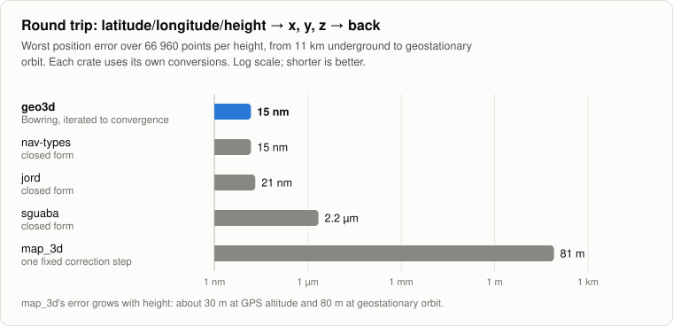
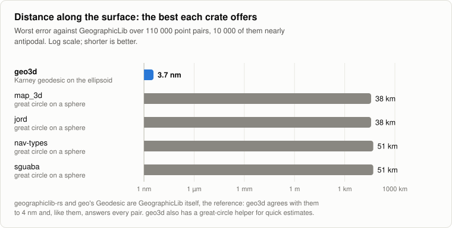
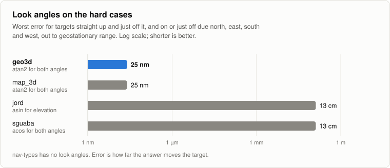
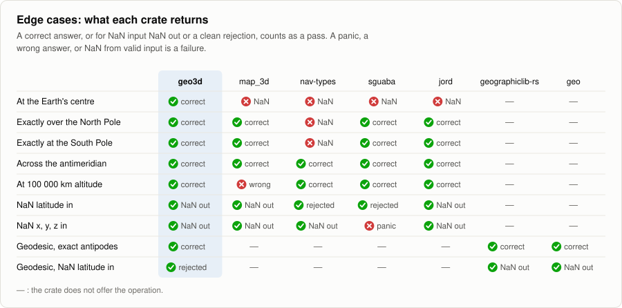
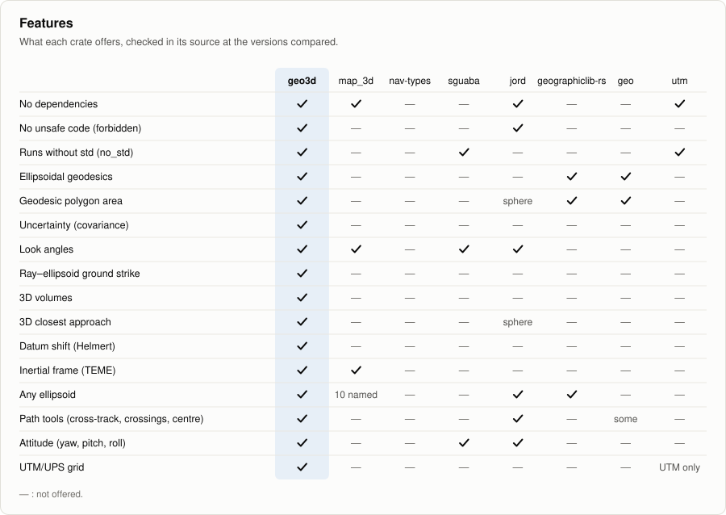
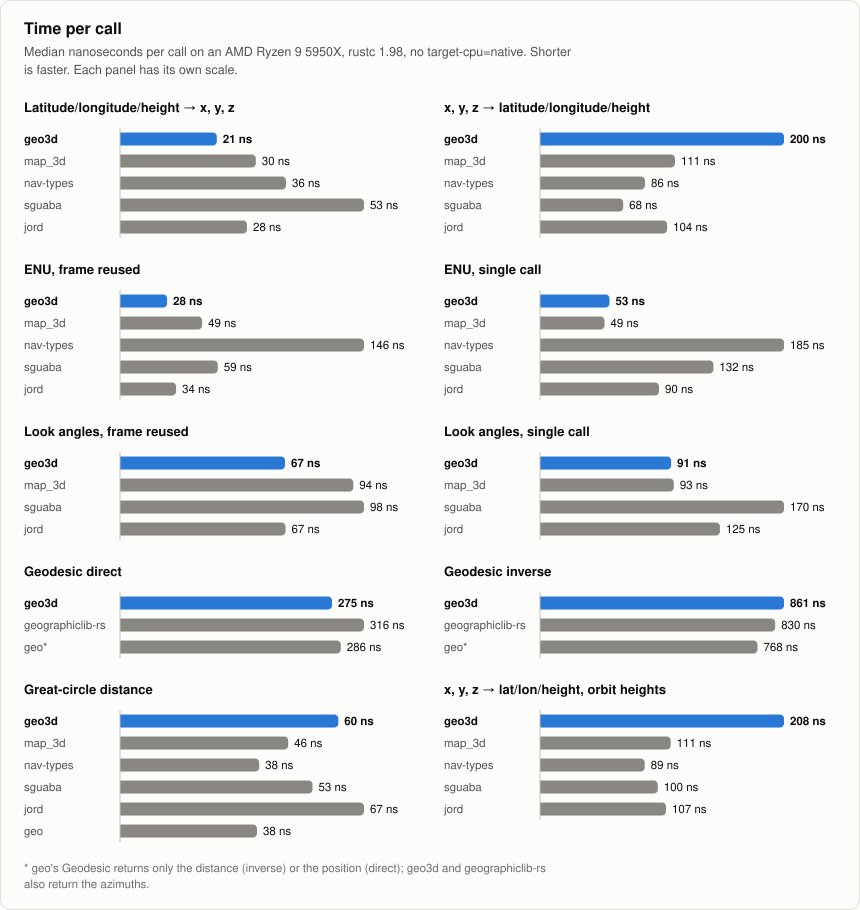

# 🌍 geo3d

[](https://crates.io/crates/geo3d)
[](https://docs.rs/geo3d)
[](https://github.com/FusionVault/geo3d/actions/workflows/ci.yml)
[](Cargo.toml)

**3D positions on Earth, made simple.**

Give geo3d a GPS position, then ask everyday questions:

- 📍 Where is that plane, seen from here?
- 📡 Which way should the antenna point?
- 📏 How far apart are they?
- 👀 Can they see each other?
- 💥 Are they going to collide?

It's pure Rust, with no dependencies.

```rust
use geo3d::{Geodetic, LocalFrame};

let me = Geodetic::new(51.5, -0.12, 30.0);          // latitude, longitude, height in metres
let plane = Geodetic::new(51.6, -0.12, 3_000.0);

let look = LocalFrame::new(me).look_angles(plane);   // which way to point
// due north, 14.9° up, 11.5 km away
assert!(look.elevation_deg > 14.0 && look.range_m > 11_000.0);
```

```bash
cargo add geo3d
```

## ✨ Why geo3d?

- 🎯 **Accurate.** Conversions are exact, and distances along the ground are good to 15 nanometres.
  Everything is tested against GeographicLib, the reference library.
- 🛡️ **Reliable.** It handles the tricky places, like the poles and opposite sides of the Earth,
  without NaN or panics.
- 🧩 **Easy to use.** Degrees and metres everywhere, with named fields. Latitude always comes first.
- 🪶 **Light and fast.** No dependencies, no `unsafe` code, and nothing allocates. Works on Rust 1.85
  and newer.

## 🗺️ The basics

Latitude and longitude are angles, so you can't subtract two of them to get a distance. geo3d turns
positions into frames where normal 3D maths works.

| Type | What it holds | Units |
|---|---|---|
| `Geodetic` | latitude, longitude and height, like GPS gives you | degrees, metres |
| `Ecef` | x, y, z from the centre of the Earth | metres |
| `Enu` / `Ned` | how far east, north and up (or north, east and down) from you | metres |
| `Aer` | azimuth, elevation and range: which way to point | degrees, metres |
| `Eci` | x, y, z that don't spin with the Earth, for satellites | metres |
| `Vec3` | a plain 3D vector, like a velocity | metres, m/s |

A few rules hold everywhere:

- Latitude comes first: `Geodetic::new(lat, lon, height)`.
- Bearings go clockwise from north, from 0° to 360°.
- Heights are above the WGS84 ellipsoid, like GPS. They are not heights above sea level.
- WGS84 is the default, but any ellipsoid works: `GRS80.to_ecef(p)`.

New to these words? The [glossary](#-glossary) explains them.

## 🍳 Recipes

Every example here runs as a test, so you can copy and paste it.

### Convert between latitude/longitude and x, y, z

```rust
use geo3d::{ecef_to_geodetic, geodetic_to_ecef, Geodetic, GRS80};

let sydney = Geodetic::new(-33.87, 151.21, 20.0);

let xyz = geodetic_to_ecef(sydney);    // x −4 646 032 m, y 2 553 122 m, z −3 534 494 m
let back = ecef_to_geodetic(xyz);      // Sydney again
assert!((back.lat_deg - sydney.lat_deg).abs() < 1e-11);

let on_grs80 = GRS80.to_ecef(sydney);  // other ellipsoids work the same way
```

### Find where something is, relative to you

```rust
use geo3d::{Geodetic, LocalFrame};

let radar = LocalFrame::new(Geodetic::new(51.5, -0.12, 30.0));
let target = Geodetic::new(51.6, -0.12, 3_000.0);

let enu = radar.enu_of(target);        // 11 131 m north, 2 960 m up
let ned = radar.ned_of(target);        // the same, as north-east-down
let back = radar.geodetic_of(enu);     // back to latitude and longitude
assert!(enu.north > 11_000.0 && ned.down < 0.0);
```

💡 Build one `LocalFrame` per observer and reuse it. Building it is the slow part.

### Work out which way to point

```rust
use geo3d::{Geodetic, LocalFrame};

let station = LocalFrame::new(Geodetic::new(-33.94, 151.18, 21.0));
let aircraft = Geodetic::new(-33.80, 151.30, 2_500.0);

let aer = station.look_angles(aircraft);  // 35.6° from north, 7.3° up, 19.3 km away
let again = station.destination(aer);     // and back to the aircraft's position
assert!(aer.is_above_horizon());
```

### Find where a line of sight hits the ground

```rust
use geo3d::{ground_strike, Geodetic};

let drone = Geodetic::new(-33.94, 151.18, 120.0);    // 120 m up

let spot = ground_strike(drone, 90.0, -30.0);        // looking east, 30° down: lands 208 m away
assert!(spot.is_some());
assert!(ground_strike(drone, 90.0, 10.0).is_none()); // looking up: it never lands
```

### Measure distance

There are three kinds of distance. Pick the one you need:

| You want | Use | Accuracy |
|---|---|---|
| A straight line through space | `distance3d_m(a, b)` | exact |
| The distance along the ground | `WGS84.geodesic_inverse(a, b)` | 15 nm |
| A quick estimate along the ground | `WGS84.great_circle_distance_m(a, b)` | within 0.6 % |

```rust
use geo3d::{distance3d_m, Geodetic, WGS84};

let lax = Geodetic::new(33.9425, -118.4081, 0.0);
let jfk = Geodetic::new(40.6413, -73.7781, 0.0);

let straight = distance3d_m(lax, jfk);                    // 3 918 745 m, through the Earth
let ground = WGS84.geodesic_inverse(lax, jfk).unwrap();   // 3 983 005 m, setting off at 65.9°
let quick = WGS84.great_circle_distance_m(lax, jfk);      // 3 974 267 m

// Or the other way round: travel that far on that bearing, and you arrive at JFK.
let (arrive, _) = WGS84.geodesic_direct(lax, ground.initial_bearing_deg, ground.distance_m);
assert!((arrive.lat_deg - jfk.lat_deg).abs() < 1e-8);
```

The distance along the ground works for any two points, even ones on opposite sides of the Earth.

### Check if something is inside a zone

Every shape answers `contains`:

```rust
use geo3d::{AltitudeBand, Cone, Cylinder, Geodetic, Sphere, Volume};

let site = Geodetic::new(0.0, 0.0, 0.0);
let p = Geodetic::new(0.0, 0.02, 500.0);  // 2.2 km east, 500 m up

let bubble = Sphere::new(site, 10_000.0);                              // within 10 km
let camera = Cone::new(site, 90.0, 0.0, 20.0, 5_000.0);                // facing east, ±20°, 5 km reach
let zone = Cylinder::new(site, 8_000.0, AltitudeBand::below(2_000.0)); // 8 km wide, up to 2 km high

assert!(bubble.contains(p) && camera.contains(p) && zone.contains(p));
```

💡 `AltitudeBand` adds a height range to any 2D shape: `band.within_prism(inside_polygon, height)`.

### Check if two objects will collide

```rust
use geo3d::{Course, Geodetic, LocalFrame, Track, WGS84};

let a_pos = Geodetic::new(-33.80, 151.30, 2_500.0);
let b_pos = Geodetic::new(-33.90, 151.25, 2_400.0);

// Heading, ground speed (m/s) and climb (m/s), turned into a 3D velocity.
let a_vel = LocalFrame::new(a_pos).velocity_of_course(Course::new(225.0, 120.0, 0.0)); // south-west
let b_vel = LocalFrame::new(b_pos).velocity_of_course(Course::new(0.0, 100.0, 0.0));   // north

let a = Track::new(WGS84.to_ecef(a_pos), a_vel);
let b = Track::new(WGS84.to_ecef(b_pos), b_vel);

let cpa = a.closest_approach(b);      // closest in 59 s, when they're 434 m apart
let alert = a.conflict(b, 1_000.0);   // Some(...) because they come within 1 km
let soon = a.at(60.0);                // where `a` will be in a minute
assert!(alert.is_some());
```

### Check if two points can see each other

```rust
use geo3d::{Geodetic, WGS84};

let plane = WGS84.to_ecef(Geodetic::new(0.0, 0.0, 10_000.0));  // 10 km up
let near = WGS84.to_ecef(Geodetic::new(0.0, 1.0, 10_000.0));   // 111 km away
let far = WGS84.to_ecef(Geodetic::new(0.0, 10.0, 10_000.0));   // 1 113 km away

assert!(WGS84.line_of_sight(plane, near));
assert!(!WGS84.line_of_sight(plane, far));        // the Earth is in the way

let horizon = WGS84.horizon_distance_m(10_000.0); // you can see about 357 km
```

💡 geo3d treats the Earth as smooth. Hills and the way air bends light aren't included.

### Track satellites

```rust
use geo3d::{eci, Ecef};

let angle = eci::gmst_from_unix(1_800_000_000.0);  // how far the Earth has turned at that time

let fixed = Ecef::new(7_000_000.0, 0.0, 0.0);
let in_space = fixed.to_eci(angle);
let back = in_space.to_ecef(angle);
assert!((back.x - fixed.x).abs() < 1e-6);
```

💡 This is the TEME frame that SGP4 satellite models use, so their output plugs straight in. It is
not J2000. Unix time is UTC, which can be up to 0.9 s away from the Earth's true rotation. That's
up to 400 m at the equator. For better accuracy, pass a UT1 date to `eci::gmst_rad`.

### Shift between datums

```rust
use geo3d::{Ecef, Helmert7};

// WGS84 → OSGB36 (Great Britain), as published: metres, arc-seconds and parts per million.
let h = Helmert7::position_vector(-446.448, 125.157, -542.060, -0.1502, -0.2470, -0.8421, 20.4894);

let p = Ecef::new(3_874_938.0, 116_218.0, 5_047_168.0);
let shifted = h.apply(p);
let back = h.apply_inverse(shifted);  // exactly reverses it
assert!(back.distance_to(p) < 1e-6);
```

💡 Datums are published with one of two sign conventions. For the other one, use
`Helmert7::coordinate_frame` with the same numbers.

## 🔁 Coming from MATLAB, pymap3d or map_3d?

Most functions have a familiar twin. Make a frame once with `let frame = LocalFrame::new(observer);`
and then:

| MATLAB / pymap3d / map_3d | geo3d |
|---|---|
| `geodetic2ecef` / `ecef2geodetic` | `geodetic_to_ecef(g)` / `ecef_to_geodetic(e)` |
| `geodetic2enu` / `enu2geodetic` | `frame.enu_of(g)` / `frame.geodetic_of(enu)` |
| `geodetic2ned` / `ned2geodetic` | `frame.ned_of(g)` / `frame.geodetic_of_ned(ned)` |
| `ecef2enu` / `enu2ecef` | `frame.to_enu(e)` / `frame.to_ecef(enu)` |
| `geodetic2aer` / `aer2geodetic` | `frame.look_angles(g)` / `frame.destination(aer)` |
| `ecef2aer` / `aer2ecef` | `frame.look_angles_ecef(e)` / `frame.ecef_of_aer(aer)` |
| `enu2aer` / `aer2enu` | `enu.to_aer()` / `aer.to_enu()` |
| `ecef2enuv` / `enu2ecefv` | `frame.dir_to_enu(v)` / `frame.dir_to_ecef(enu)` |
| `lookAtSpheroid` | `frame.ground_strike(azimuth, elevation)` |
| `vdist` / `distance` | `WGS84.geodesic_inverse(a, b)` |
| `vreckon` / `reckon` | `WGS84.geodesic_direct(a, bearing, distance)` |
| `ecef2eci` / `eci2ecef` | `e.to_eci(gmst)` / `i.to_ecef(gmst)` |

Everything is in degrees, so there's no `deg` flag to remember.

## 📊 How it compares

We tested geo3d against five other Rust crates, giving them all the same inputs. The
[full comparison](comparisons/README.md) has every number, and shows how to run it yourself.

### 🎯 Converting x, y, z back to latitude and longitude

<picture>
  <source media="(prefers-color-scheme: dark)" srcset="comparisons/charts/roundtrip-dark.svg">
  
</picture>

geo3d solves this with an exact formula, then checks the last nanometre. It stays exact from deep
inside the Earth out to satellite heights. map_3d takes a single approximate step, and drifts 81 m
that far out.

### 📏 Distance along the ground

<picture>
  <source media="(prefers-color-scheme: dark)" srcset="comparisons/charts/surface-distance-dark.svg">
  
</picture>

geo3d measures distance on the Earth's real, slightly squashed shape, just like GeographicLib. The
other crates assume a perfect sphere, which can be tens of kilometres out on a long trip.

### 📡 Pointing straight up

<picture>
  <source media="(prefers-color-scheme: dark)" srcset="comparisons/charts/look-angles-dark.svg">
  
</picture>

geo3d uses a formula that stays precise in every direction. Some crates lose precision when
pointing straight up, and end up 13 cm off at satellite distances.

### 🛡️ Tricky cases

<picture>
  <source media="(prefers-color-scheme: dark)" srcset="comparisons/charts/robustness-dark.svg">
  
</picture>

geo3d gives a correct answer in every case we tried. Other crates return NaN at the Earth's centre
or the poles, give a wrong answer far out in space, or panic.

### 🧰 Features

<picture>
  <source media="(prefers-color-scheme: dark)" srcset="comparisons/charts/features-dark.svg">
  
</picture>

Only geo3d has ground strikes, 3D zones, collision checks and datum shifts, and it does it with no
dependencies. Other crates are ahead on n-vectors and attitude. Both are on our
[roadmap](https://github.com/FusionVault/geo3d/issues).

### ⚡ Speed

<picture>
  <source media="(prefers-color-scheme: dark)" srcset="comparisons/charts/speed-dark.svg">
  
</picture>

geo3d is the fastest, or level with the fastest, in five of the ten tests. It's slower in the other
five, and we know why:

- **x, y, z back to latitude and longitude** (two of the tests). geo3d is about 10 % behind map_3d
  and jord here, and further behind nav-types and sguaba. It spends that time on a final check
  that makes it the most accurate of the five.
- **One-off ENU conversions.** A `LocalFrame` costs a little to build, and pays off from the second
  target onwards.
- **Quick great-circle distance.** geo3d uses a formula that stays exact on the far side of the Earth.
- **Distance along the ground.** It's about 4 % behind geographiclib-rs.

💡 To use your CPU's fused multiply-add, build with `RUSTFLAGS="-C target-cpu=native"`.

## 📐 Accuracy

| What | How accurate |
|---|---|
| Latitude/longitude/height → x, y, z | exact |
| x, y, z → latitude/longitude/height | 3 nm near the Earth, 20 nm at satellite heights |
| Local frames, pointing, ground strikes and zones | exact, even straight up |
| Distance and travel along the ground | 15 nm, for any two points |
| Great-circle estimates and horizon distance | within 0.6 % |
| Closest approach | exact for objects moving in straight lines |
| Datum shifts | exact for the published numbers |
| Satellite frame (`eci`) | exact rotation; up to 400 m from treating UTC as UT1 |

"Exact" means exact apart from normal floating-point rounding. The tests check every row against
GeographicLib or an independent crate.

## 🧩 Optional features

They're all off by default, so a plain `cargo add geo3d` pulls in nothing else.

| Feature | What it adds |
|---|---|
| `serde` | saving and loading every type |
| `mint` | conversions to `mint` types, and through them to `cgmath` and others |
| `glam` | conversions to `glam::DVec3` |
| `nalgebra` | conversions to `nalgebra` vectors and points |
| `geo-types` | `Geodetic` ↔ `geo_types::Point` (x is longitude, y is latitude) |

```bash
cargo add geo3d --features glam,serde
```

```rust,ignore
let v: glam::DVec3 = geo3d::Ecef::new(1.0, 2.0, 3.0).into();
let p: geo_types::Point = geo3d::Geodetic::new(-33.87, 151.21, 20.0).into(); // x = lon, y = lat
```

## 🚧 Not included (yet)

- **2D shapes** like polygons: use [`geo`](https://crates.io/crates/geo).
- **Map grids** like UTM and MGRS: use [`utm`](https://crates.io/crates/utm) or
  [`proj`](https://crates.io/crates/proj) for now. UTM is on our roadmap.
- **Height above sea level**, terrain, and the way air bends light.
- **High-precision Earth rotation** (precession and nutation).

## 📖 Glossary

- **Ellipsoid:** the smooth, slightly squashed ball we measure positions on. GPS uses WGS84.
- **Geodetic:** latitude, longitude and height.
- **ECEF:** x, y, z in metres from the centre of the Earth, spinning with it.
- **ENU / NED:** east-north-up or north-east-down, measured from where you stand.
- **AER:** azimuth (compass direction), elevation (angle above the horizon) and range (distance).
- **ECI:** like ECEF, but not spinning with the Earth. Used for satellites.
- **TEME:** the version of ECI that SGP4 satellite models use.
- **Geodesic:** the shortest path along the ground.
- **Great circle:** the shortest path on a perfect sphere. A quick stand-in for a geodesic.
- **Datum:** a reference frame for coordinates. Helmert numbers convert between two of them.

## 🤝 Contributing

Contributions are very welcome! The [contributing guide](CONTRIBUTING.md) shows how to get started,
and the [roadmap](https://github.com/FusionVault/geo3d/issues) lists what's planned. Issues marked
[good first issue](https://github.com/FusionVault/geo3d/issues?q=is%3Aopen+label%3A%22good+first+issue%22)
are a great place to begin.

## 📄 License

Apache-2.0. See the [license](LICENSE) and the [changelog](CHANGELOG.md).
