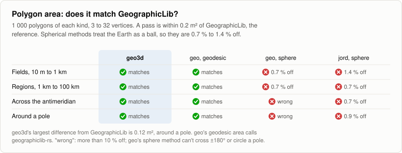
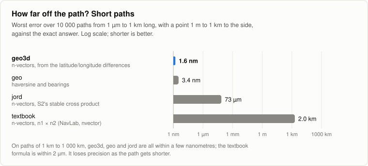
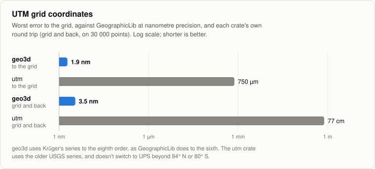
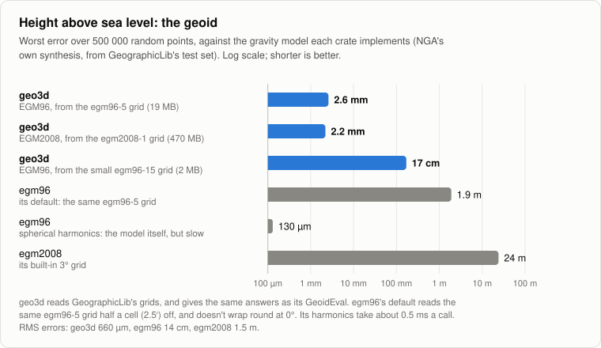
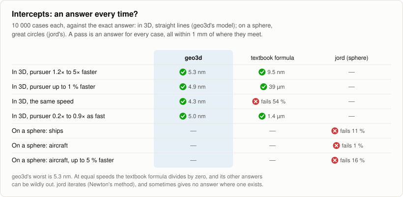
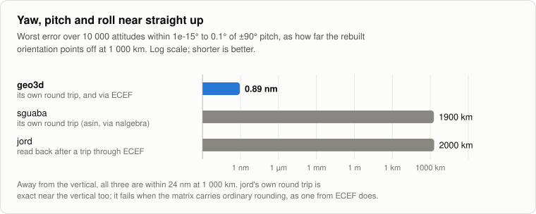

# 🌍 geo3d

[](https://crates.io/crates/geo3d)
[](https://docs.rs/geo3d)
[](https://github.com/FusionVault/geo3d/actions/workflows/ci.yml)
[](Cargo.toml)

**3D positions on Earth, made simple.**

Give geo3d a GPS position, then ask everyday questions:

- 📍 Where is that plane, seen from here?
- 📡 Which way should the antenna point?
- 📏 How far apart are they?
- 🗺️ How big is that field?
- 👀 Can they see each other?
- 💥 Are they going to collide?
- 🎯 How fast is it closing, and how soon can we reach it?
- 🌊 How high above sea level is it?

It's pure Rust, with no dependencies.

```rust
use geo3d::{Geodetic, LocalFrame};

let me = Geodetic::new(51.5, -0.12, 30.0);          // latitude, longitude, height in metres
let plane = Geodetic::new(51.6, -0.12, 3_000.0);

let look = LocalFrame::new(me).look_angles(plane);   // which way to point
// due north, 14.9° up, 11.5 km away
assert!(look.elevation_deg > 14.0 && look.range_m > 11_000.0);
```

```bash
cargo add geo3d
```

## ✨ Why geo3d?

- 🎯 **Accurate.** Conversions are exact, and distances along the ground are good to 15 nanometres.
  Everything is tested against GeographicLib, the reference library.
- 🛡️ **Reliable.** It handles the tricky places, like the poles and opposite sides of the Earth,
  without NaN or panics.
- 🧩 **Easy to use.** Degrees and metres everywhere, with named fields. Latitude always comes first.
- 🪶 **Light and fast.** No dependencies, no `unsafe` code, and nothing allocates. Works on Rust 1.85
  and newer, and on microcontrollers too, without the standard library.

## 🗺️ The basics

Latitude and longitude are angles, so you can't subtract two of them to get a distance. geo3d turns
positions into frames where normal 3D maths works.

| Type | What it holds | Units |
|---|---|---|
| `Geodetic` | latitude, longitude and height, like GPS gives you | degrees, metres |
| `Ecef` | x, y, z from the centre of the Earth | metres |
| `Enu` / `Ned` | how far east, north and up (or north, east and down) from you | metres |
| `Aer` | azimuth, elevation and range: which way to point | degrees, metres |
| `Eci` | x, y, z that don't spin with the Earth, for satellites | metres |
| `Vec3` | a plain 3D vector, like a velocity | metres, m/s |
| `Cov3` | how uncertain a position is (a covariance) | metres², degrees² |
| `Attitude` | which way a vehicle faces: yaw, pitch and roll | degrees |
| `Frd` | an offset in a vehicle's own frame: forward, right, down | metres |
| `Quaternion` | the same turn as yaw, pitch and roll, as four numbers | none |
| `UtmUps` | a UTM or UPS grid position: zone, easting and northing | metres |

A few rules hold everywhere:

- Latitude comes first: `Geodetic::new(lat, lon, height)`.
- Bearings go clockwise from north, from 0° to 360°.
- Heights are above the WGS84 ellipsoid, like GPS, not above sea level. A `Geoid` converts between
  the two.
- WGS84 is the default, but any ellipsoid works: `GRS80.to_ecef(p)`. All 50 in the EPSG registry are
  built in.
- Everything prints: `println!("{p}")` shows `-33.87°, 151.21°, 20 m`.

New to these words? The [glossary](#-glossary) explains them.

## 🍳 Recipes

Every example here runs as a test, so you can copy and paste it.

### Convert between latitude/longitude and x, y, z

```rust
use geo3d::{ecef_to_geodetic, geodetic_to_ecef, Geodetic, GRS80};

let sydney = Geodetic::new(-33.87, 151.21, 20.0);

let xyz = geodetic_to_ecef(sydney);    // x −4 646 032 m, y 2 553 122 m, z −3 534 494 m
let back = ecef_to_geodetic(xyz);      // Sydney again
assert!((back.lat_deg - sydney.lat_deg).abs() < 1e-11);

let on_grs80 = GRS80.to_ecef(sydney);  // other ellipsoids work the same way
```

### Use another country's ellipsoid

The common ones are named, and every ellipsoid in the [EPSG registry](https://epsg.org) can be
looked up by its code:

```rust
use geo3d::{Ellipsoid, Geodetic, CGCS2000, KRASSOVSKY_1940};

let beijing = Geodetic::new(39.9042, 116.4074, 50.0);
let on_cgcs2000 = CGCS2000.to_ecef(beijing);        // China's datum, which BeiDou uses
let on_krassovsky = KRASSOVSKY_1940.to_ecef(beijing); // the older Beijing 1954 and Pulkovo 1942

let everest = Ellipsoid::from_epsg(7044).unwrap();    // Everest 1830 (1962 Definition), Pakistan
let custom = Ellipsoid::from_axes(6_378_206.4, 6_356_583.8); // or define one by its two radii
assert_eq!(Ellipsoid::from_epsg(7024), Some(KRASSOVSKY_1940));
```

💡 An ellipsoid is only the shape. Coordinates on an older datum, like Pulkovo 1942, are also
shifted against WGS84 by up to a few hundred metres. To move between datums, use `Helmert7`.

### Print positions

Every type prints in a readable form, and plain `{}` keeps every digit:

```rust
use geo3d::{Geodetic, LocalFrame};

let sydney = Geodetic::new(-33.87, 151.21, 20.0);
assert_eq!(format!("{sydney}"), "-33.87°, 151.21°, 20 m");
assert_eq!(format!("{sydney:.5}"), "-33.87000°, 151.21000°, 20.0 m");   // fixed decimals
assert_eq!(format!("{sydney:#}"), "33.87° S, 151.21° E, 20 m");         // N/S/E/W

let look = LocalFrame::new(sydney).look_angles(Geodetic::new(-33.80, 151.30, 2_500.0));
assert_eq!(format!("{look:.1}"), "az 47.0°, el 12.2°, 11657 m");
```

💡 With `{:.N}`, angles get N decimals and metres four fewer, since 0.0001° is about 10 m on the
ground. Grid positions print the way GeographicLib writes them: `56s 334435.706 6250816.398`.

### Use UTM grid coordinates

UTM covers the world in 60 zones of easting and northing in metres, with UPS for the polar caps:

```rust
use geo3d::{Geodetic, WGS84};

let sydney = Geodetic::new(-33.87, 151.21, 20.0);
let grid = WGS84.to_utm_ups(sydney).unwrap();   // zone 56 south: 334 436 E, 6 250 816 N
let back = WGS84.from_utm_ups(grid).unwrap();   // Sydney again, at height 0 (the grid is flat)
assert_eq!((grid.zone, grid.north), (56, false));
assert!((back.lat_deg - sydney.lat_deg).abs() < 1e-12);
```

💡 Zone 0 is UPS, near the poles. `to_utm_ups_zone` keeps nearby data in one zone. For other
grids built on the same projection, such as the British National Grid or Gauss–Krüger zones, use
`TransverseMercator::new(ellipsoid, scale)`.

### Get height above sea level

GPS heights are above the ellipsoid, and sea level can be up to 106 m below it or 85 m above. A
geoid grid gives the difference. Download one from
[GeographicLib](https://geographiclib.sourceforge.io/C++/doc/geoid.html#geoidinst): egm96-5 (19 MB)
holds EGM96, the model most GPS receivers use, and egm2008-1 (470 MB) is the most accurate.

```rust,no_run
use geo3d::{Geodetic, Geoid, GeoidGrid};

let bytes = std::fs::read("egm96-5.pgm").expect("download it from GeographicLib");
let egm96 = GeoidGrid::from_pgm(bytes).unwrap();

let fix = Geodetic::new(-33.87, 151.21, 42.5);      // from GPS: 42.5 m above the ellipsoid
let above_sea = egm96.sea_level_height_m(fix);       // 20.04 m above sea level
let everest = egm96.geodetic_from_sea_level(27.9881, 86.925, 8_848.86); // 8 820.12 m for GPS
```

💡 The answers are the same as GeographicLib's, and within 3 mm of the EGM96 model. Any function
`|lat, lon| metres` is a `Geoid` too, so a national model plugs straight in.

### Find where something is, relative to you

```rust
use geo3d::{Geodetic, LocalFrame};

let radar = LocalFrame::new(Geodetic::new(51.5, -0.12, 30.0));
let target = Geodetic::new(51.6, -0.12, 3_000.0);

let enu = radar.enu_of(target);        // 11 131 m north, 2 960 m up
let ned = radar.ned_of(target);        // the same, as north-east-down
let back = radar.geodetic_of(enu);     // back to latitude and longitude
assert!(enu.north > 11_000.0 && ned.down < 0.0);
```

💡 Build one `LocalFrame` per observer and reuse it. Building it is the slow part.

### Work out which way to point

```rust
use geo3d::{Geodetic, LocalFrame};

let station = LocalFrame::new(Geodetic::new(-33.94, 151.18, 21.0));
let aircraft = Geodetic::new(-33.80, 151.30, 2_500.0);

let aer = station.look_angles(aircraft);  // 35.6° from north, 7.3° up, 19.3 km away
let again = station.destination(aer);     // and back to the aircraft's position
assert!(aer.is_above_horizon());
```

### Use yaw, pitch and roll

Turn a vehicle's heading, pitch and roll into where things are around it:

```rust
use geo3d::{Attitude, Frd, Geodetic, LocalFrame};

let drone = LocalFrame::new(Geodetic::new(-33.94, 151.18, 120.0));
let pose = Attitude::new(90.0, -5.0, 0.0);      // heading east, nose 5° down

// What the camera sees 500 m ahead and 30 m below the nose line:
let spot = drone.geodetic_of_body(pose, Frd::new(500.0, 0.0, 30.0));   // about 47 m up
let again = drone.body_of(pose, spot);                                  // and back again
assert!((again.forward - 500.0).abs() < 1e-6);

let q = pose.to_quaternion();                   // w, x, y, z, as PX4 and MAVLink store it
assert_eq!(geo3d::Attitude::from_quaternion(q).roll_deg, 0.0);
```

💡 Yaw is the heading (clockwise from north), pitch is nose up, and roll is right wing down.
`drone.body_to_ecef_rotation(pose)` gives the whole rotation into x, y, z, and
`attitude_from_ecef_rotation` reads one back. Both stay exact pointing straight up or down, where
yaw and roll are easy to lose track of.

### Carry uncertainty between frames

Measurements come with errors. A `Cov3` (a covariance) describes them, and moves between frames
with the position:

```rust
use geo3d::{Aer, Cov3, Geodetic, LocalFrame};

let radar = LocalFrame::new(Geodetic::new(-33.94, 151.18, 21.0));
let hit = Aer::new(40.0, 10.0, 50_000.0);               // what the radar measured
let noise = Cov3::from_std_devs([0.2, 0.2, 20.0]);      // ±0.2°, ±0.2°, ±20 m

let enu = hit.cov_to_enu(noise);          // ±134 m east, ±114 m north, ±172 m up
let ecef = radar.enu_cov_to_ecef(enu);    // ready for a tracker that works in x, y, z
assert!((enu.std_devs()[2] - 171.9).abs() < 0.1);
```

💡 Moving between ENU, NED and x, y, z is exact. Pointing and latitude/longitude conversions are
"first order": accurate while the errors are small next to the distance.

### Find where a line of sight hits the ground

```rust
use geo3d::{ground_strike, Geodetic};

let drone = Geodetic::new(-33.94, 151.18, 120.0);    // 120 m up

let spot = ground_strike(drone, 90.0, -30.0);        // looking east, 30° down: lands 208 m away
assert!(spot.is_some());
assert!(ground_strike(drone, 90.0, 10.0).is_none()); // looking up: it never lands
```

### Measure distance

There are three kinds of distance. Pick the one you need:

| You want | Use | Accuracy |
|---|---|---|
| A straight line through space | `distance3d_m(a, b)` | exact |
| The distance along the ground | `WGS84.geodesic_inverse(a, b)` | 15 nm |
| A quick estimate along the ground | `WGS84.great_circle_distance_m(a, b)` | within 0.6 % |

```rust
use geo3d::{distance3d_m, Geodetic, WGS84};

let lax = Geodetic::new(33.9425, -118.4081, 0.0);
let jfk = Geodetic::new(40.6413, -73.7781, 0.0);

let straight = distance3d_m(lax, jfk);                    // 3 918 745 m, through the Earth
let ground = WGS84.geodesic_inverse(lax, jfk).unwrap();   // 3 983 005 m, setting off at 65.9°
let quick = WGS84.great_circle_distance_m(lax, jfk);      // 3 974 267 m

// Or the other way round: travel that far on that bearing, and you arrive at JFK.
let (arrive, _) = WGS84.geodesic_direct(lax, ground.initial_bearing_deg, ground.distance_m);
assert!((arrive.lat_deg - jfk.lat_deg).abs() < 1e-8);
```

The distance along the ground works for any two points, even ones on opposite sides of the Earth.

### Measure an area

List the corners in order, and get the area and the distance around:

```rust
use geo3d::{Geodetic, WGS84};

let field = [
    Geodetic::new(-33.870, 151.200, 0.0),
    Geodetic::new(-33.870, 151.210, 0.0),
    Geodetic::new(-33.860, 151.210, 0.0),
    Geodetic::new(-33.860, 151.200, 0.0),
];
let size = WGS84.polygon_area(&field).unwrap();  // 1 026 350 m² (about 1 km²), 4 069 m around
assert!((size.area_m2 - 1_026_349.8).abs() < 0.1);
```

💡 The sign tells you the order. Counter-clockwise corners (seen from above) give a positive area,
and clockwise ones a negative area. Use `size.area_m2.abs()` if you don't mind which way round.

The edges are the shortest paths between corners. Areas around a pole or across the antimeridian
work as they are.

### Follow a route

How far off the route is it, and how far along?

```rust
use geo3d::{Geodetic, WGS84};

let sydney = Geodetic::new(-33.95, 151.18, 0.0);
let melbourne = Geodetic::new(-37.67, 144.84, 0.0);
let plane = Geodetic::new(-35.31, 149.19, 10_000.0);

let off = WGS84.cross_track_distance_m(sydney, melbourne, plane);    // 10.6 km to the left
let along = WGS84.along_track_distance_m(sydney, melbourne, plane);  // 236 km along the way
let halfway = WGS84.great_circle_interpolate(sydney, melbourne, 0.5);
assert!((off + 10_580.0).abs() < 1.0);
```

💡 There's also `great_circle_intersection` (where two routes cross) and `mean_position` (the
centre of a group of positions). The [NavLab examples](src/navlab.rs) walk through ten classic
navigation problems.

These use a sphere, like the great-circle distance, and they're exact on it at any length, from a
micrometre to thousands of kilometres.

### Check if something is inside a zone

Every shape answers `contains`:

```rust
use geo3d::{AltitudeBand, Cone, Cylinder, Geodetic, Sphere, Volume};

let site = Geodetic::new(0.0, 0.0, 0.0);
let p = Geodetic::new(0.0, 0.02, 500.0);  // 2.2 km east, 500 m up

let bubble = Sphere::new(site, 10_000.0);                              // within 10 km
let camera = Cone::new(site, 90.0, 0.0, 20.0, 5_000.0);                // facing east, ±20°, 5 km reach
let zone = Cylinder::new(site, 8_000.0, AltitudeBand::below(2_000.0)); // 8 km wide, up to 2 km high

assert!(bubble.contains(p) && camera.contains(p) && zone.contains(p));
```

💡 `AltitudeBand` adds a height range to any 2D shape: `band.within_prism(inside_polygon, height)`.

### Check if two objects will collide

```rust
use geo3d::{Course, Geodetic, LocalFrame, Track, WGS84};

let a_pos = Geodetic::new(-33.80, 151.30, 2_500.0);
let b_pos = Geodetic::new(-33.90, 151.25, 2_400.0);

// Heading, ground speed (m/s) and climb (m/s), turned into a 3D velocity.
let a_vel = LocalFrame::new(a_pos).velocity_of_course(Course::new(225.0, 120.0, 0.0)); // south-west
let b_vel = LocalFrame::new(b_pos).velocity_of_course(Course::new(0.0, 100.0, 0.0));   // north

let a = Track::new(WGS84.to_ecef(a_pos), a_vel);
let b = Track::new(WGS84.to_ecef(b_pos), b_vel);

let cpa = a.closest_approach(b);      // closest in 59 s, when they're 434 m apart
let alert = a.conflict(b, 1_000.0);   // Some(...) because they come within 1 km
let soon = a.at(60.0);                // where `a` will be in a minute
assert!(alert.is_some());
```

### Measure closing speed and plan an intercept

```rust
use geo3d::{Course, Geodetic, LocalFrame, Track, WGS84};

let radar = LocalFrame::new(Geodetic::new(-33.95, 151.18, 10.0));
let plane = Track::new(
    WGS84.to_ecef(Geodetic::new(-33.80, 151.18, 3_000.0)),     // 17 km north, 3 km up
    radar.velocity_of_course(Course::new(180.0, 120.0, 0.0)),  // flying south at 120 m/s
);

let rate = radar.range_rate_mps(plane);             // −118 m/s: it's closing
let doppler_hz = -2.0 * rate * 3e9 / 299_792_458.0; // +2.4 kHz on a 3 GHz radar

// A drone at the radar, flying straight at 70 m/s: when, where, and which way?
let meet = plane.intercept_from(radar.origin_ecef(), 70.0).unwrap();      // in 91 s
let way = radar.course_of_velocity(meet.velocity);                        // north, climbing
let slowest = plane.slowest_intercept_from(radar.origin_ecef()).unwrap(); // 21 m/s would do
assert!(rate < 0.0 && (meet.time_s - 91.45).abs() < 0.01);
```

💡 Range rate is negative while things close. The Doppler shift is `−2 × range rate × f / c` for a
radar, and `−range rate × f / c` one way. Intercepts are exact, like `closest_approach`, for
straight lines at a steady speed.

### Check if two points can see each other

```rust
use geo3d::{Geodetic, WGS84};

let plane = WGS84.to_ecef(Geodetic::new(0.0, 0.0, 10_000.0));  // 10 km up
let near = WGS84.to_ecef(Geodetic::new(0.0, 1.0, 10_000.0));   // 111 km away
let far = WGS84.to_ecef(Geodetic::new(0.0, 10.0, 10_000.0));   // 1 113 km away

assert!(WGS84.line_of_sight(plane, near));
assert!(!WGS84.line_of_sight(plane, far));        // the Earth is in the way

let horizon = WGS84.horizon_distance_m(10_000.0); // you can see about 357 km
```

💡 For radar and radio, use `line_of_sight_with_refraction` and `horizon_distance_with_refraction_m`
with `STANDARD_REFRACTION_K`. The air bends radio waves around the Earth, so they reach about 15 %
further. geo3d treats the Earth as smooth, so hills aren't included.

### Track satellites

```rust
use geo3d::{eci, Ecef};

let angle = eci::gmst_from_unix(1_800_000_000.0);  // how far the Earth has turned at that time

let fixed = Ecef::new(7_000_000.0, 0.0, 0.0);
let in_space = fixed.to_eci(angle);
let back = in_space.to_ecef(angle);
assert!((back.x - fixed.x).abs() < 1e-6);
```

💡 This is the TEME frame that SGP4 satellite models use, so their output plugs straight in. It is
not J2000. Unix time is UTC, which can be up to 0.9 s away from the Earth's true rotation. That's
up to 400 m at the equator. For full accuracy, use `eci::gmst_from_unix_with_dut1(t, dut1)` with
DUT1 from the IERS Bulletin A.

💡 `Track::from_eci(position, velocity, angle)` brings in SGP4's velocity too, with the Earth's spin
taken off, so `LocalFrame::range_rate_mps` gives the Doppler shift to tune for.

💡 `cargo run --example satellite` tracks the International Space Station from Brisbane, using the
[`sgp4`](https://crates.io/crates/sgp4) crate, down to the Doppler shift on its radio.

### Shift between datums

```rust
use geo3d::{Ecef, Helmert7};

// WGS84 → OSGB36 (Great Britain), as published: metres, arc-seconds and parts per million.
let h = Helmert7::position_vector(-446.448, 125.157, -542.060, -0.1502, -0.2470, -0.8421, 20.4894);

let p = Ecef::new(3_874_938.0, 116_218.0, 5_047_168.0);
let shifted = h.apply(p);
let back = h.apply_inverse(shifted);  // exactly reverses it
assert!(back.distance_to(p) < 1e-6);
```

💡 Datums are published with one of two sign conventions. For the other one, use
`Helmert7::coordinate_frame` with the same numbers.

## 🚀 Examples

Complete programs for real jobs, in [`examples/`](examples). Run one with
`cargo run --example radar`.

| Example | What it does |
|---|---|
| [`radar`](examples/radar.rs) | An airport radar: where to point, the plane's Doppler shift, and how sure the fix is |
| [`air_traffic`](examples/air_traffic.rs) | Which flights are in controlled airspace, and will two come too close? |
| [`satellite`](examples/satellite.rs) | The Space Station passing over Brisbane: where to point, and the radio's Doppler shift |
| [`drone_camera`](examples/drone_camera.rs) | Where a drone's camera is looking, and the position of what its laser hits |
| [`field_survey`](examples/field_survey.rs) | A paddock from its GPS corners: area, fence lengths and map grid references |
| [`search_and_rescue`](examples/search_and_rescue.rs) | Reaching a drifting yacht: how soon, which way to steer, when you'll see it |
| [`flight_route`](examples/flight_route.rs) | Sydney to Los Angeles: distance, waypoints, and how far a plane has strayed |
| [`sea_level`](examples/sea_level.rs) | GPS heights to heights above sea level, with a geoid grid |

## 🔁 Coming from MATLAB, pymap3d or map_3d?

Most functions have a familiar twin. Make a frame once with `let frame = LocalFrame::new(observer);`
and then:

| MATLAB / pymap3d / map_3d | geo3d |
|---|---|
| `geodetic2ecef` / `ecef2geodetic` | `geodetic_to_ecef(g)` / `ecef_to_geodetic(e)` |
| `geodetic2enu` / `enu2geodetic` | `frame.enu_of(g)` / `frame.geodetic_of(enu)` |
| `geodetic2ned` / `ned2geodetic` | `frame.ned_of(g)` / `frame.geodetic_of_ned(ned)` |
| `ecef2enu` / `enu2ecef` | `frame.to_enu(e)` / `frame.to_ecef(enu)` |
| `geodetic2aer` / `aer2geodetic` | `frame.look_angles(g)` / `frame.destination(aer)` |
| `ecef2aer` / `aer2ecef` | `frame.look_angles_ecef(e)` / `frame.ecef_of_aer(aer)` |
| `enu2aer` / `aer2enu` | `enu.to_aer()` / `aer.to_enu()` |
| `ecef2enuv` / `enu2ecefv` | `frame.dir_to_enu(v)` / `frame.dir_to_ecef(enu)` |
| `lookAtSpheroid` | `frame.ground_strike(azimuth, elevation)` |
| `vdist` / `distance` | `WGS84.geodesic_inverse(a, b)` |
| `vreckon` / `reckon` | `WGS84.geodesic_direct(a, bearing, distance)` |
| `areaint` | `WGS84.polygon_area(&corners)` |
| `gcxgc` | `WGS84.great_circle_intersection(a1, a2, b1, b2)` |
| `meanm` | `WGS84.mean_position(&points)` |
| `ecef2eci` / `eci2ecef` | `e.to_eci(gmst)` / `i.to_ecef(gmst)` |
| `utmzone` | `UtmUps::standard_zone(g)` |
| `projfwd` / `projinv` with UTM | `WGS84.to_utm_ups(g)` / `WGS84.from_utm_ups(u)` |
| `referenceEllipsoid(7024)` / `Ellipsoid.from_name(name)` | `Ellipsoid::from_epsg(7024)`, or a named one like `KRASSOVSKY_1940` |
| `geoidheight` / `egm96geoid` | `grid.undulation_m(lat, lon)`, with a `GeoidGrid` |
| `angle2dcm` / `dcm2angle` | `Attitude::new(yaw, pitch, roll).to_rotation()` / `Attitude::from_rotation(m)` (MATLAB's matrix is the transpose: NED to body) |

Everything is in degrees, so there's no `deg` flag to remember.

## 📊 How it compares

We tested geo3d against nine other Rust crates, giving them all the same inputs. The
[full comparison](comparisons/README.md) has every number, and shows how to run it yourself.

### 🎯 Converting x, y, z back to latitude and longitude

<picture>
  <source media="(prefers-color-scheme: dark)" srcset="comparisons/charts/roundtrip-dark.svg">
  
</picture>

geo3d solves this with an exact formula, then checks the last nanometre. It stays exact from deep
inside the Earth out to satellite heights. map_3d takes a single approximate step, and drifts 81 m
that far out.

### 📏 Distance along the ground

<picture>
  <source media="(prefers-color-scheme: dark)" srcset="comparisons/charts/surface-distance-dark.svg">
  
</picture>

geo3d measures distance on the Earth's real, slightly squashed shape, just like GeographicLib. The
other crates assume a perfect sphere, which can be tens of kilometres out on a long trip.

### 🗺️ Area

<picture>
  <source media="(prefers-color-scheme: dark)" srcset="comparisons/charts/polygon-area-dark.svg">
  
</picture>

geo3d's areas match GeographicLib, from a 10 m field to a ring around the South Pole. Methods that
treat the Earth as a ball are 0.7 % to 1.4 % out, and geo's breaks across the antimeridian and
around the poles.

### 🧭 How far off the path?

<picture>
  <source media="(prefers-color-scheme: dark)" srcset="comparisons/charts/cross-track-dark.svg">
  
</picture>

geo3d builds each path from the latitude and longitude differences, so it stays exact on paths of
any length. The textbook n-vector formula, used in the NavLab examples, loses precision as the path
gets shorter, and can be kilometres out on a path a few micrometres long.

### 🗺️ UTM grid coordinates

<picture>
  <source media="(prefers-color-scheme: dark)" srcset="comparisons/charts/utm-dark.svg">
  
</picture>

geo3d agrees with GeographicLib to 2 nm, and gets you back where you started to within 4 nm. The
utm crate uses older formulas: under a millimetre to the grid, but up to 77 cm off on the way back.
It also gives zone 61 on the 180° meridian, puts the equator 10 000 km south, and doesn't switch to
UPS near the poles.

### 🌊 Height above sea level

<picture>
  <source media="(prefers-color-scheme: dark)" srcset="comparisons/charts/geoid-dark.svg">
  
</picture>

geo3d reads GeographicLib's standard geoid grids and gives the same answers as GeographicLib:
within 3 mm of the EGM96 and EGM2008 models everywhere. The egm96 crate uses the same grid, but
reads it half a grid cell off, so it can be 1.9 m out. The egm2008 crate's built-in grid has
points 3° apart, and is up to 24 m out.

### 🎯 Intercepts

<picture>
  <source media="(prefers-color-scheme: dark)" srcset="comparisons/charts/intercept-dark.svg">
  
</picture>

geo3d finds the intercept within a few nanometres every time, even at equal speeds. The textbook
quadratic formula divides by zero there, and fails in half the cases. jord moves along great circles
on a sphere and solves by iteration, which sometimes gives no answer where one exists.

### ✈️ Yaw, pitch and roll near straight up

<picture>
  <source media="(prefers-color-scheme: dark)" srcset="comparisons/charts/attitude-dark.svg">
  
</picture>

Pointing straight up, yaw and roll turn about the same axis. geo3d reads them out so they always
rebuild the same orientation. sguaba loses track there, and so does jord once the attitude has been
through ECEF, as one from an inertial navigation system has: both can come back pointing the wrong
way entirely.

### 📡 Pointing straight up

<picture>
  <source media="(prefers-color-scheme: dark)" srcset="comparisons/charts/look-angles-dark.svg">
  
</picture>

geo3d uses a formula that stays precise in every direction. Some crates lose precision when
pointing straight up, and end up 13 cm off at satellite distances.

### 🛡️ Tricky cases

<picture>
  <source media="(prefers-color-scheme: dark)" srcset="comparisons/charts/robustness-dark.svg">
  
</picture>

geo3d gives a correct answer in every case we tried. Other crates return NaN at the Earth's centre
or the poles, give a wrong answer far out in space, or panic.

### 🧰 Features

<picture>
  <source media="(prefers-color-scheme: dark)" srcset="comparisons/charts/features-dark.svg">
  
</picture>

Only geo3d has ground strikes, 3D zones, collision checks, uncertainty and datum shifts, and it does
it with no dependencies.

### ⚡ Speed

<picture>
  <source media="(prefers-color-scheme: dark)" srcset="comparisons/charts/speed-dark.svg">
  
</picture>

geo3d is the fastest, or level with the fastest, in seven of the fifteen tests. It's slower in the
other eight, and we know why:

- **x, y, z back to latitude and longitude** (two of the tests). geo3d is about 10 % behind map_3d
  and jord here, and further behind nav-types and sguaba. It spends that time on a final check
  that makes it the most accurate of the five.
- **One-off ENU conversions.** A `LocalFrame` costs a little to build, and pays off from the second
  target onwards.
- **Quick great-circle distance.** geo3d uses a formula that stays exact on the far side of the Earth.
- **Distance along the ground.** It's about 4 % behind geographiclib-rs.
- **UTM, both ways.** The utm crate is quicker (1.5× to the grid, 4× back), but uses older formulas
  that are up to 77 cm out on a round trip. geo3d's are good to a few nanometres.
- **Height above sea level.** The egm96 and egm2008 crates are 2–3× quicker, but up to 1.9 m and
  24 m out. geo3d fits a cubic to 12 grid points, which keeps it within 3 mm.

💡 To use your CPU's fused multiply-add, build with `RUSTFLAGS="-C target-cpu=native"`.

## 📐 Accuracy

| What | How accurate |
|---|---|
| Latitude/longitude/height → x, y, z | exact |
| x, y, z → latitude/longitude/height | 3 nm near the Earth, 20 nm at satellite heights |
| Local frames, pointing, ground strikes and zones | exact, even straight up |
| Distance and travel along the ground | 15 nm, for any two points |
| Polygon area | within 0.2 m² of GeographicLib, for any polygon |
| UTM/UPS and map projections | 5 nm (within 2 nm of GeographicLib) |
| Height above sea level (`GeoidGrid`) | the same as GeographicLib: within 3 mm of EGM96 (egm96-5 grid) and EGM2008 (egm2008-1) |
| Yaw, pitch and roll | exact, even pointing straight up or down |
| Uncertainty between frames | exact for ENU, NED and x, y, z; first order for pointing and latitude/longitude |
| Great-circle tools (distance, route, crossings, centre) and horizon distance | within 0.6 %; exact on a sphere |
| Closest approach, range rate and intercepts | exact for objects moving in straight lines (intercepts to a few nanometres, even at equal speeds) |
| Datum shifts | exact for the published numbers |
| Ellipsoids | EPSG's own defining numbers, all 50 checked against the registry |
| Satellite frame (`eci`) | exact rotation; up to 400 m from treating UTC as UT1 |

"Exact" means exact apart from normal floating-point rounding. The tests check every row against
GeographicLib or an independent crate.

## 🧩 Optional features

None of them are needed: a plain `cargo add geo3d` pulls in nothing else.

| Feature | What it adds |
|---|---|
| `std` | on by default: the standard library's maths. Nothing to download; it comes with Rust |
| `libm` | runs without the standard library, for microcontrollers (see below) |
| `serde` | saving and loading every type |
| `mint` | conversions to `mint` types, and through them to `cgmath` and others |
| `glam` | conversions to `glam::DVec3`, `Cov3` to `glam::DMat3`, and `Quaternion` to `glam::DQuat` |
| `nalgebra` | conversions to `nalgebra` vectors and points, `Cov3` to `Matrix3`, and `Quaternion` |
| `geo-types` | `Geodetic` ↔ `geo_types::Point` (x is longitude, y is latitude) |

```bash
cargo add geo3d --features glam,serde
```

```rust,ignore
let v: glam::DVec3 = geo3d::Ecef::new(1.0, 2.0, 3.0).into();
let p: geo_types::Point = geo3d::Geodetic::new(-33.87, 151.21, 20.0).into(); // x = lon, y = lat
```

## 🔌 Without an operating system

On a microcontroller or a flight controller there's no standard library, so the maths (sine, cosine,
square root) has to come from somewhere else. Turn on `libm`, Rust's own maths library written in
pure Rust:

```bash
cargo add geo3d --no-default-features --features libm
```

Everything else stays the same: the same API, nothing allocates, and the other features work too.

Geoid grids work there too. `GeoidGrid::from_pgm(include_bytes!("egm96-15.pgm"))` reads a 2 MB
grid straight from flash, without copying it.

💡 If you have the standard library, keep it. Its maths rounds the last digit more carefully. libm
is 10–20 % faster, and its answers agree with the standard build to within 25 nm for positions
(out to 40 000 km) and half a square metre on areas the size of a continent.

## 🚧 Not included (yet)

- **2D shape operations** like joining polygons or testing if a point is inside one: use
  [`geo`](https://crates.io/crates/geo). geo3d does measure polygon areas.
- **MGRS grid references** (like `56HLH3443550816`): on our
  [roadmap](https://github.com/FusionVault/geo3d/issues/22). Other projections: use
  [`proj`](https://crates.io/crates/proj) for now.
- **Terrain:** the height of the ground itself.
- **High-precision Earth rotation** (precession and nutation).

## 📖 Glossary

- **Ellipsoid:** the smooth, slightly squashed ball we measure positions on. GPS uses WGS84.
- **Geoid:** the shape sea level would take with no tides, winds or currents. It's up to 106 m
  below the ellipsoid and 85 m above it. Heights above the geoid are heights above sea level.
- **EGM96 / EGM2008:** the standard models of the geoid. EGM2008 is newer and more detailed.
- **Geodetic:** latitude, longitude and height.
- **ECEF:** x, y, z in metres from the centre of the Earth, spinning with it.
- **ENU / NED:** east-north-up or north-east-down, measured from where you stand.
- **AER:** azimuth (compass direction), elevation (angle above the horizon) and range (distance).
- **ECI:** like ECEF, but not spinning with the Earth. Used for satellites.
- **TEME:** the version of ECI that SGP4 satellite models use.
- **Geodesic:** the shortest path along the ground.
- **Antimeridian:** the line at 180° longitude, where east meets west.
- **Great circle:** the shortest path on a perfect sphere. A quick stand-in for a geodesic.
- **n-vector:** the unit vector pointing straight up out of the surface at a position. Maths with
  n-vectors has no trouble at the poles or the antimeridian.
- **Datum:** a reference frame for coordinates. Helmert numbers convert between two of them.
- **EPSG:** the standard registry of datums, ellipsoids and coordinate systems. Each one has a
  number, like 7030 for the WGS84 ellipsoid.
- **Map projection:** a way of flattening the curved Earth onto a map, in metres.
- **UTM / UPS:** a world grid in metres: 60 north–south strips (UTM), plus two polar caps (UPS).
- **no_std:** Rust without its standard library, for chips with no operating system.
- **Attitude:** which way a vehicle faces: its yaw (heading), pitch (nose up) and roll (right wing
  down).
- **Body frame (FRD):** axes fixed to a vehicle: forward out of the nose, right out of the right
  wing, down out of the belly.
- **Quaternion:** four numbers that describe a turn. Flight controllers use them because, unlike
  yaw, pitch and roll, they have no trouble pointing straight up.
- **Range rate:** how fast the distance to something is changing. Negative while it comes closer.
  A radar measures it from the **Doppler shift**: the change in frequency of the echo.
- **Intercept:** where and when a pursuer flying straight at a steady speed meets a moving target.
- **Covariance:** how uncertain a position is in each direction, and how the errors are linked. The
  square roots of its diagonal are the standard deviations.

## 🤝 Contributing

Contributions are very welcome! The [contributing guide](CONTRIBUTING.md) shows how to get started,
and the [roadmap](https://github.com/FusionVault/geo3d/issues) lists what's planned. Issues marked
[good first issue](https://github.com/FusionVault/geo3d/issues?q=is%3Aopen+label%3A%22good+first+issue%22)
are a great place to begin.

## 📄 License

Apache-2.0. See the [license](LICENSE) and the [changelog](CHANGELOG.md).
